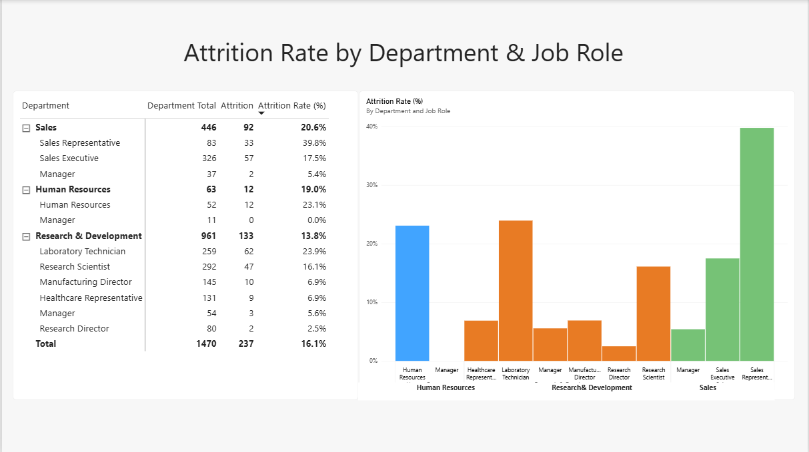
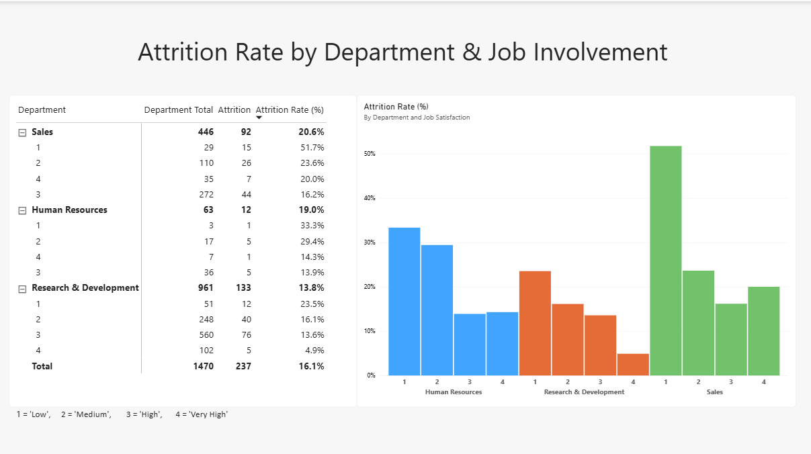
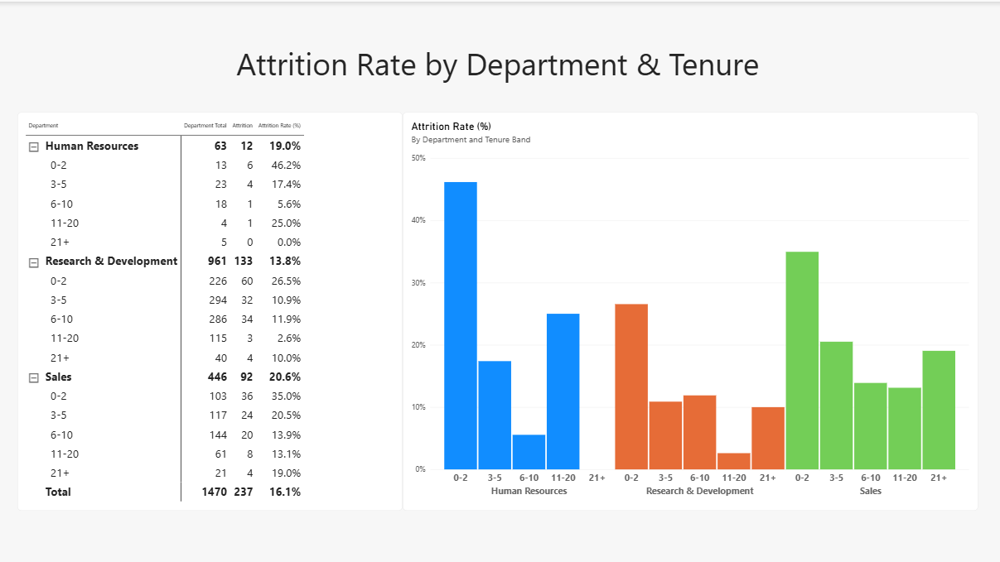

# Power BI Dashboard

### Overview
Three screenshots of three separate, but related, Power BI dashboards. Each dashboard is interactive and depicts the attrition rate by department and one other factor. Those factors are Job Role, Job Involvement, and Tenure.

### Attrition by Department and Job Role

Notice that the Sales department and employees who work as Sales Representatives have the highest attrition rates (39.8% attrition by department) in the dataset. 

### Attrition by Department and Job Involvement

Notice that the employees in the Sales department who experience low job satisfaction have the highest attrition rates (51.7% attrition by department) in the dataset. 

### Attrition by Department and Tenure

Notice that the employees in the HR department who have been at the company for less than two years have highest attrition rates (46.2% attrition by department) in the dataset. 
