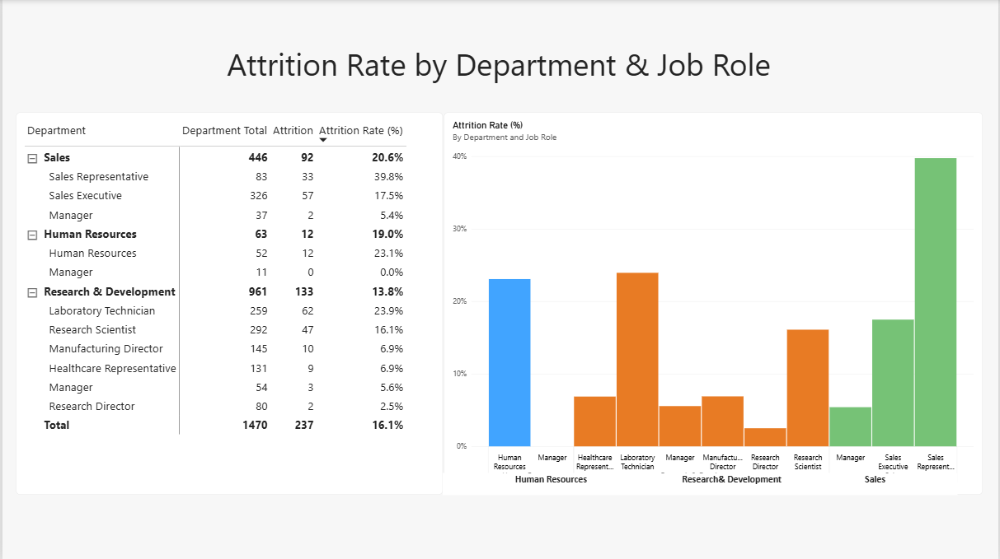

# IBM Retention Analysis & AI Agent Overview

### Summary:

This project seeks to determine which groups of employees are most likely to leave in IBM’s fictional HR dataset and how an AI Development Plan Assistant (AI Agent) could reduce attrition. This project has three parts: A Python and SQL analysis, three Power BI dashboard, and an AI Agent.

### Key Findings:

#### Analysis:
The categories with the highest attrition rates are: 
1) Sales Representatives (39.8% attrition vs. 16% overall)
2) Employees with low job involvement (33.7% attrition vs. 16% overall)
3) Employees who work overtime (30.5% attrition for 'Yes' vs. 10.4% for 'No')
4) Employees who have been at the company for less than two years (29.8% attrition vs. 16% overall).

Additionally, I calculated a rough estimate of 2.5 million dollars lost from the 237 employees who left IBM based on [The Center for American Progress's (CAP)](https://www.americanprogress.org/article/there-are-significant-business-costs-to-replacing-employees/) attrition cost estimates categorized by salary.

Access this part of the project [here](analysis/README.md)

#### Dashboard:

1) Sales department and employees who work as Sales Representatives have the highest attrition rates (39.8% attrition by department) in the dataset
2) Employees in the Sales department who experience low job satisfaction have the highest attrition rates (51.7% attrition by department) in the dataset
3) Employees in the HR department who have been at the company for less than two years have highest attrition rates (46.2% attrition by department) in the dataset

Access this part of the project [here](analysis/DASHBOARD.md)

#### AI Development Plan Assistant (AI Agent)
The AI agent is tested on fourteen randomly selected profiles from the IBM dataset with every output reviewed by the same scorer.

From version one to version three we achieved a 6.16% (4.71/5 to 5/5) increase in relevance, 12.87% (4.43/5 to 5/5) increase in accuracy, and a 27.23% (3.93/5 to 5/5) increase in actionability for all AI outputs. Testing on three random profiles showed age-based differences in all 3 profiles, so the final tool leaves out demographic data and requires a person to review each plan.
